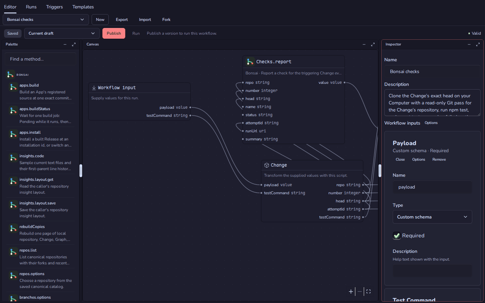
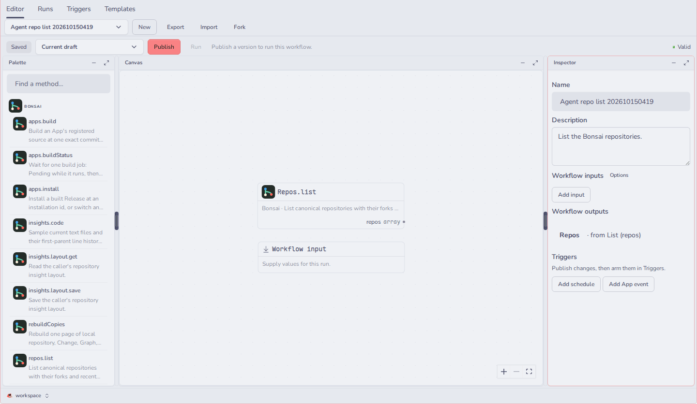

# Trellis (`@fungi.computer/trellis`)

Trellis builds and runs workflows: typed graphs of your Apps' methods, started
by hand, on a schedule or by an event.



Trellis is one of the starter Apps of
[Oyster](https://github.com/fungi-computer/oyster), the open App host that runs
on your own Cloudflare account. On Oyster, each run executes on Cloudflare
Workflows, and its steps call the same App methods your agents use.

## What you can do

- Drag methods from the **Palette** onto the **Canvas**, wire their typed ports,
  and set inputs in the **Inspector**. Trellis checks the graph as you edit and
  marks it **Valid** when it can run.
- Add review steps, waits, conditions, repeats and maps, or a **Code** node that
  runs your own JavaScript in a sandbox with a time limit.
- **Publish** an immutable version, then **Run** it with inputs. Drafts never
  run.
- Follow a run in **Runs**: each step's state, outputs, duration and cost, with
  image and video previews. Approve or reject review steps there; only a person
  can answer a review.
- Arm a published version in **Triggers** to start on a schedule, on an App
  event such as a Bonsai push or merge, or from a webhook, and have it report
  its ending to one of your chats.
- Start from **Templates**: Bonsai checks (run `npm test` on each Change and
  report the result), Build on merge, Review a result, Storyboard (panels from
  Prints with a review per beat) and Storyboard + Save to git.
- **Export**, **Import** and **Fork** workflows as JSON.



## Get it

Trellis installs with the other starter Apps. On a deployed Oyster (see the
[Oyster quick start](https://github.com/fungi-computer/oyster#quick-start-deploy-your-own-oyster)),
run:

```sh
export OYSTER_URL=https://oyster.<your-subdomain>.workers.dev
export OYSTER_OWNER_KEY=<your owner key>
npx oyster install-apps
```

The installer clones this repository and the six others, seeds each on your
Oyster with `git push`, builds them on your Computer and installs them. Sign in
at `$OYSTER_URL/login` with the owner key and open Trellis from the Tourtois
desktop. Run `install-apps` again to update; each App keeps its data.

## Change it

Every installed App is also a template you can fork on your own Oyster. Fork
Trellis into a Bonsai repository and clone it with ordinary `git`:

```sh
curl -X POST -H "Authorization: Bearer $OYSTER_OWNER_KEY" -H 'content-type: application/json' \
  -d '{"appId":"app_trellis","name":"my-trellis"}' \
  $OYSTER_URL/apps/bonsai/methods/apps.fork
git -c http.extraHeader="Authorization: Bearer $OYSTER_OWNER_KEY" \
  clone $OYSTER_URL/git/bonsai/my-trellis.git
```

The reply names your fork's App id and repository. Push your edits, open the
repository in Bonsai and choose **Settings**, then **Build & install** with that
App id and your commit as `git:<sha>`. Install the Release at `trellis` to
replace the running Trellis, or at a new id to keep both.

To work from GitHub instead, fork this repository and point the installer at
your forks with `--repositories <base URL>` and `--ref <branch or tag>`. The
installer reads all seven starter Apps from that base, so fork them under one
account.

## How workflows are stored

Drafts live in Trellis's own SQLite database and save as you edit. Publishing
writes `workflows/<id>.json` to the installation's `trellis` git repository and
tags it `<id>@v<n>`, so every version that ever ran stays readable. Pick an old
version in the version menu and choose **Restore as draft** to edit it again. A
run records the exact version it started from, and Oyster checks the caller's
permissions again before each step.

## Agent tools

Agents call Trellis through Oyster's MCP endpoint, or at
`POST $OYSTER_URL/apps/trellis/methods/<name>` with a key; see
[Git, keys and MCP](https://github.com/fungi-computer/oyster#git-keys-and-mcp).

| Method                                               | What it does                                                                       |
| ---------------------------------------------------- | ---------------------------------------------------------------------------------- |
| `catalog`                                            | Lists your installed Apps' methods, or one App's full port types.                  |
| `listWorkflows` / `loadWorkflow`                     | Lists the library, or reads one workflow.                                          |
| `saveDraft`                                          | Saves a draft, with a revision check so concurrent edits never clobber each other. |
| `publishWorkflow` / `listVersions` / `revertDraft`   | Publishes a version, lists versions, or restores one as a draft.                   |
| `runWorkflow`                                        | Runs a published version, optionally reporting the ending to a chat.               |
| `listRuns` / `runStatus` / `cancel`                  | Lists runs, reads one run's steps and reviews, or cancels it.                      |
| `arm` / `armEventTrigger` and their `disarm` pairs   | Arms or disarms a schedule or an App-event trigger.                                |
| `exportWorkflow` / `importWorkflow` / `forkWorkflow` | Moves workflows in and out as JSON, or copies one.                                 |

`answerReview` exists too, but only a person can answer a review.

## Build and check

Trellis is a React App built with Vite. The canvas uses React Flow, the panes
[Maosaico](https://github.com/fungi-computer/maosaico) and the controls
[Caps](https://github.com/fungi-computer/caps).

```sh
pnpm install
pnpm build
pnpm typecheck
pnpm test
```

[src/editor/](src/editor/) is the graph editor, [src/runs/](src/runs/) the run
view and reviews, and [src/triggers/](src/triggers/) the trigger page.
[backend/library.ts](backend/library.ts) owns drafts and publication, and
[templates/](templates/) holds the bundled templates as JSON. The agent tools
are in [backend/methods.ts](backend/methods.ts) and
[backend/library-methods.ts](backend/library-methods.ts), and
[package.json](package.json) declares the permissions the App asks for.

## License

MIT. See [LICENSE](LICENSE).

## This repository

This repository is generated from the App's directory in the Fungi monorepo
for each release. Its `@fungi.computer` dependencies are pinned to their
published versions and `pnpm-lock.yaml` resolves them from npm, so
`pnpm install --frozen-lockfile` and `pnpm build` work here, and
`oyster install-apps` builds it. The App's tests share fixtures with the
rest of the monorepo, so they run there and are not part of this repository.
